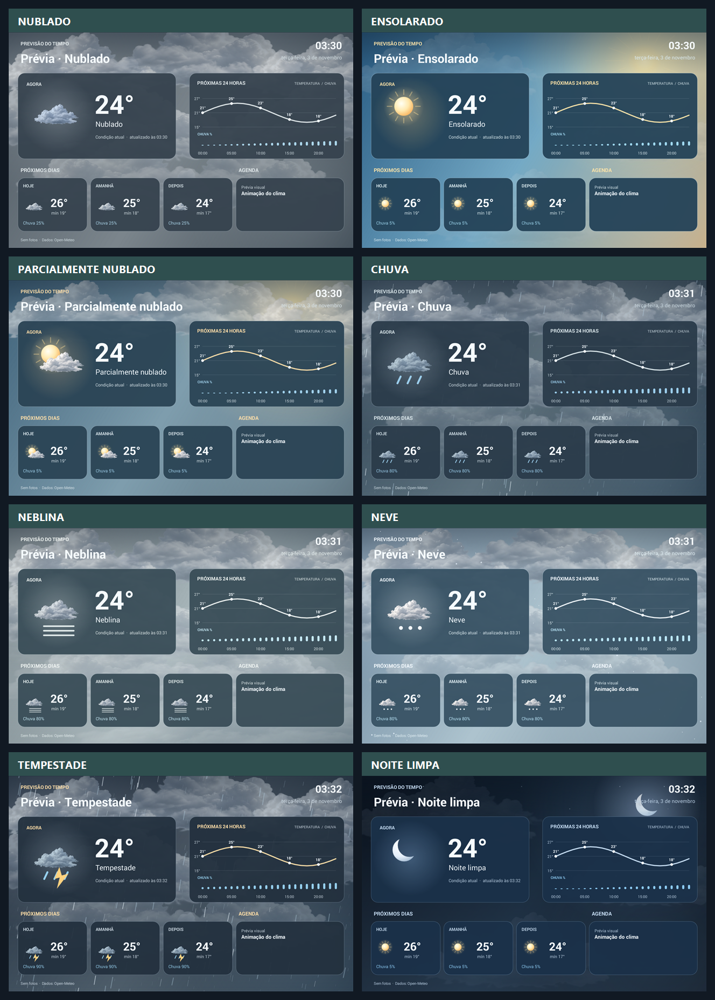

# Painel do Tablet

Painel Android para o T1060B (Android 4.4), com três telas: **Fotos**, **Clima** e
**Internet**. A tela padrão é o carrossel de fotos, trocando a imagem a cada 18
segundos. Toque em **Clima** ou no resumo do tempo sobre a foto para deixar a
previsão fixa na tela; toque em **Fotos** para voltar. **Internet** mostra o
velocímetro de download, a latência, o upload, o histórico das últimas 24 medições
e a média.

O teste de internet baixa até 4 MB, envia 1 MB e mede a latência no servidor da
Cloudflare. Ele roda automaticamente a cada 3 horas, somente com Wi-Fi e fora do
descanso noturno. O botão **Medir agora**, na linha do resumo, inicia um teste
manual. O mostrador usa três faixas de cor — até 10 Mbps (lento), de 10 a 25
(regular) e acima de 25 (bom) — e varre do zero a cada nova medição, com ícone de
Wi-Fi ao lado do status da conexão. São até 8 testes por dia, cerca de 40 MB por
dia ou 1,2 GB por mês. Não é uma medição da velocidade máxima contratada. Se o
upload não puder ser medido, a tela mostra apenas o download e a latência.

O descanso noturno vem ativado das **23:00 às 07:00**, configurável em
**Configurar**. Nesse período, o painel cobre a tela de preto e reduz o brilho
ao mínimo, mantendo o tablet e a tela ativos para acordar automaticamente no
horário escolhido. Um toque na tela escura mostra o painel por 2 minutos. Se o
Wi-Fi cair, o painel avisa e pausa os testes automáticos até a conexão voltar.

O clima usa dados atuais, horários e diários do Open-Meteo. A paleta acompanha
o tempo: céu azul com luz dourada no sol, cinza quando está encoberto mesmo à
noite, tons de aço na chuva e azul profundo nas noites de céu aberto. Mostra
ícones com nuvens texturizadas,
gráfico de temperatura das próximas 24 horas (começando na hora atual) e chance
de chuva, previsão de três dias e agenda do tablet. Na tela Clima, o sol tem halo
e raios suaves; em dias nublados, nuvens grandes em camadas cobrem o céu; à noite
clara há lua e estrelas; e na chuva caem gotas finas pela tela. As nuvens do dia
nublado deslizam em um ciclo suave sem abrir espaços no céu. O sol ganha brilho
pulsante e nuvens altas, as estrelas cintilam à noite, e neblina, neve e
tempestades têm movimentos próprios. A textura das nuvens fica no próprio
aplicativo, sem download para desenhar a cena. Os cartões são mais opacos para
manter os dados legíveis. A animação pausa fora da tela Clima e no descanso.

As gotas de chuva são desenhadas em três planos, com tamanhos, velocidades,
brilho e inclinação diferentes. A tempestade usa mais gotas e vento mais forte;
as linhas são agrupadas para manter a animação leve no Android 4.4. Os cartões
da aba Clima têm aproximadamente **95% de opacidade** em todas as paletas, para
que nuvens e precipitação não prejudiquem a leitura. Veja o [registro das
melhorias visuais](CHANGELOG.md).



As imagens acima usam dados de exemplo. Para assistir às animações, abra
[`previews/clima/index.html`](previews/clima/index.html) localmente no navegador.
As fotos pessoais exibidas na aba Fotos vêm do armazenamento do tablet e não
fazem parte deste repositório.

Todo cartão da tela Clima abre em tela cheia ao toque, com um realce enquanto o
dedo está em cima. **AGORA** busca a previsão na hora e avisa se a temperatura
mudou ("Sem mudança · 24 °C" ou "24 °C → 25 °C"). **Próximas 24 horas** abre o
gráfico detalhado, com a curva, o valor de hora em hora e as barras de chuva.
**HOJE**, **AMANHÃ** e **DEPOIS** mostram a previsão hora a hora daquele dia —
no dia de hoje uma linha marca a hora atual —, sem novo download, porque os 72
pontos horários já vêm no mesmo pedido do Open-Meteo. **Agenda** mostra os
compromissos dos próximos 14 dias em letra maior, com a data acima do título.
Para fechar, toque fora do card ou no **✗**. Sem conexão, os últimos dados
continuam na tela com a hora em que foram recebidos.

O painel lê JPG, JPEG, PNG e WebP diretamente do cartão microSD, incluindo
subpastas, e aceita uma pasta extra informada em **Configurar**. A varredura
completa acontece a cada 5 minutos ou na hora em que o cartão é inserido,
removido ou indexado — não a cada minuto. A lista fica salva em disco, então as
fotos aparecem já na abertura do painel. A ordem pode ser aleatória ou
cronológica (mais recentes primeiro), e o rodapé mostra o nome e a data da foto
em exibição. Uma foto que falhar no decode volta sozinha 10 minutos depois, em
vez de sumir. As imagens são reduzidas ao tamanho da tela antes de ocupar
memória. Sem fotos no cartão, usa `Pictures/Painel` na memória do tablet. Fotos
da rede ainda dependem da origem que o usuário escolher (pasta compartilhada,
NAS ou serviço de nuvem).

Na tela de fotos vale o **modo limpo**: sem toque por 5 segundos, o relógio, o
menu, o resumo do clima, o rodapé da foto e **Configurar** desaparecem com um
fade, e qualquer toque traz tudo de volta e reinicia a contagem. Nas telas Clima
e Internet o menu fica sempre visível, e a janela Configurar suspende o modo
limpo enquanto estiver aberta. A foto é exibida **inteira, sem corte**, sobre um
fundo formado por uma cópia bem desfocada da própria imagem — as faixas laterais
não ficam pretas.

No Android 6 ou mais novo o painel pede as permissões de leitura de fotos e de
agenda na primeira abertura; no Android 4.4 elas são concedidas na instalação.
O tablet usado hoje roda o Android 4.4 e continua sendo o alvo do projeto
(`minSdk 19`).

Para compilar, configure o Android SDK no arquivo local `local.properties`
(`sdk.dir=...`) ou em `ANDROID_HOME` e use JDK 17 ou superior. O wrapper do
Gradle 9.3.1 está dentro do próprio projeto, então não é preciso ter Gradle
instalado nem apontar para nenhuma outra pasta:

```powershell
cd tablet-panel
.\gradlew.bat assembleDebug
adb install -r app\build\outputs\apk\debug\app-debug.apk
```

A instalação com `-r` preserva cidade, horários, ordem das fotos e histórico de
medições.

O Android 4.4 deste aparelho tem dados antigos de horário de verão e exibia
Brasília uma hora adiantada em novembro de 2026. No aparelho, o fuso automático
foi desativado e escolhido **Argentina (Buenos Aires)**, que usa GMT-03:00.
